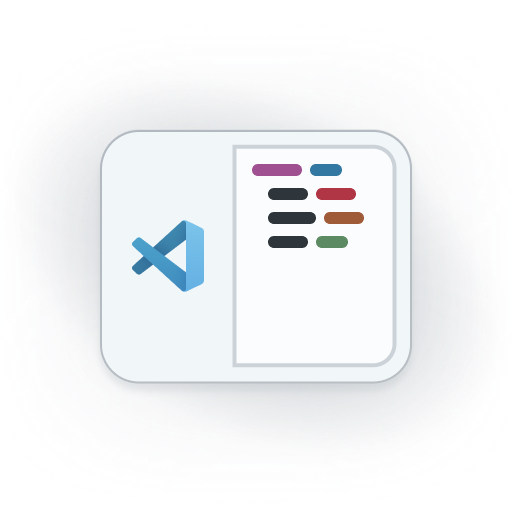
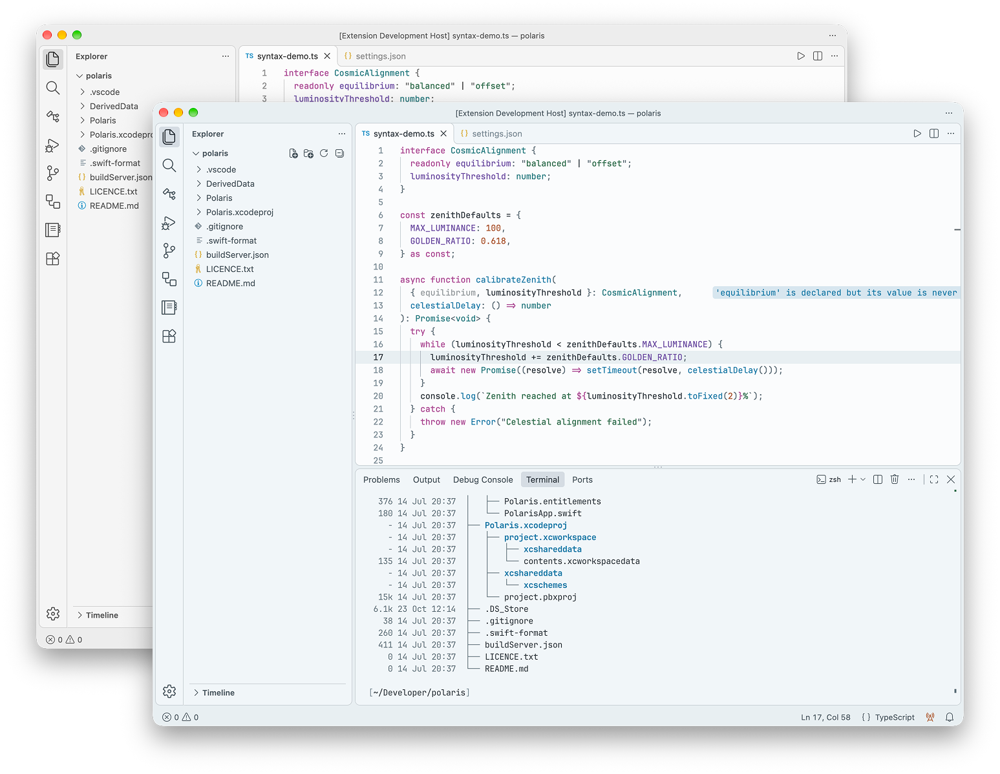

<div align="center">
  
  <h1>Meridian Theme for VS Code</h1>
  <p>
    <strong>A refined light theme with cohesive colors and complete UI coverage.</strong>
    <br>
    Comes in 💙 blue-tinted and 🩶 neutral variants.
    <br>
    Check out the 🌚 dark theme here: <a href="https://marketplace.visualstudio.com/items?itemName=britown.vscode-theme-zenith">Zenith Theme for VS Code</a>.
  </p>
  <br>
</div>



> [!NOTE]
> Updated for VS Code [Modern UI](https://code.visualstudio.com/blogs/2026/10/15/modern-ui). The updated themes are backward compatible, but you can switch to "Meridian (Legacy)" or "Meridian Neutral (Legacy)" if you prefer the old style.

## Installation

1. Install theme from the VS Code Marketplace ([direct link](https://marketplace.visualstudio.com/items?itemName=britown.vscode-theme-meridian))
2. Set your `Color Theme` to `Meridian`
3. Set your `File Icon Theme` to `Meridian` for file icons that match the theme colors
4. (Optional) Apply the suggested settings below

## Suggested settings

**Editor tabs**

VS Code themes cannot customize the hover background for Modern UI's default "connected" editor tabs. They also cannot add a bottom border without it crossing the active tab. Use the settings below as workarounds for your chosen `workbench.experimental.modernUIEditorTabStyle`:

```json
"workbench.colorCustomizations": {
  "[Meridian]": {
    // Connected tabs (default)
    "modernEditorTab.activeHoverBackground": "#fafcfd",
    "modernEditorTab.hoverBackground": "#00000000",

    // Pill tabs
    // "editorGroupHeader.border": "#cdd3d7",
    // "tab.inactiveForeground": "#505b62",
    // "tab.unfocusedInactiveForeground": "#505b62"
  },
  "[Meridian Neutral]": {
    // Connected tabs (default)
    "modernEditorTab.activeHoverBackground": "#fcfcfc",
    "modernEditorTab.hoverBackground": "#00000000",

    // Pill tabs
    // "editorGroupHeader.border": "#d2d2d2",
    // "tab.inactiveForeground": "#595959",
    // "tab.unfocusedInactiveForeground": "#595959"
  }
}
```

**Font**

The font in the screenshot is [JetBrains Mono](https://www.jetbrains.com/lp/mono/) with these these settings:

```json
"editor.fontFamily": "JetBrains Mono",
"editor.fontLigatures": true, // If you want ligatures.
"editor.fontSize": 13,

"terminal.integrated.fontFamily": "JetBrains Mono",
"terminal.integrated.fontLigatures": true, // If you want ligatures.
"terminal.integrated.fontSize": 13,
"terminal.integrated.lineHeight": 1.1,
```

**UI elements**

```json
// Tone down the use of colors in Explorer and Editor.
"explorer.decorations.colors": false,
"outline.problems.colors": false,
"workbench.editor.decorations.colors": false,
"editor.bracketPairColorization.enabled": false,

// Extend Editor line highlight into gutter, adjust Scrollbar and resize indicator (Sash) sizes, and align Explorer file icons.
"editor.renderLineHighlight": "all",
"editor.scrollbar.horizontalScrollbarSize": 10,
"editor.scrollbar.verticalScrollbarSize": 10,
"workbench.tree.indent": 18,
"workbench.tree.renderIndentGuides": "none",
"workbench.sash.size": 2,
```

**Extensions**

Apply these you use the following extensions:

```json
"errorLens.borderRadius": "4px",
"errorLens.margin": "2ch",
"errorLens.messageBackgroundMode": "message",
"errorLens.padding": "1px 4px",

"gitlens.currentLine.fontStyle": "italic",
```

**Other**

[suggested-settings.json](https://github.com/bkuzmanoski/vscode-theme-meridian/blob/main/suggested-settings.json) contains these and other theme- and layout-related settings for easy copy-and-pasting.

## Acknowledgments

The syntax highlighting colors were inspired by the "zenwritten_light" Ghostty theme ([mbadolato/iTerm2-Color-Schemes](https://github.com/mbadolato/iTerm2-Color-Schemes)) which was in turn taken from [mcchrish/zenbones.nvim](https://github.com/mcchrish/zenbones.nvim).

The file icon theme uses the Seti UI icons ([jesseweed/seti-ui](https://github.com/jesseweed/seti-ui)).

---

Found a bug or have a request? Please [open an issue](https://github.com/bkuzmanoski/vscode-theme-meridian/issues).
