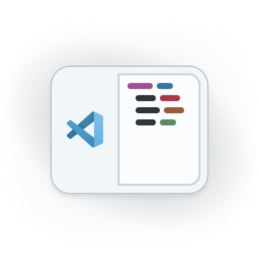
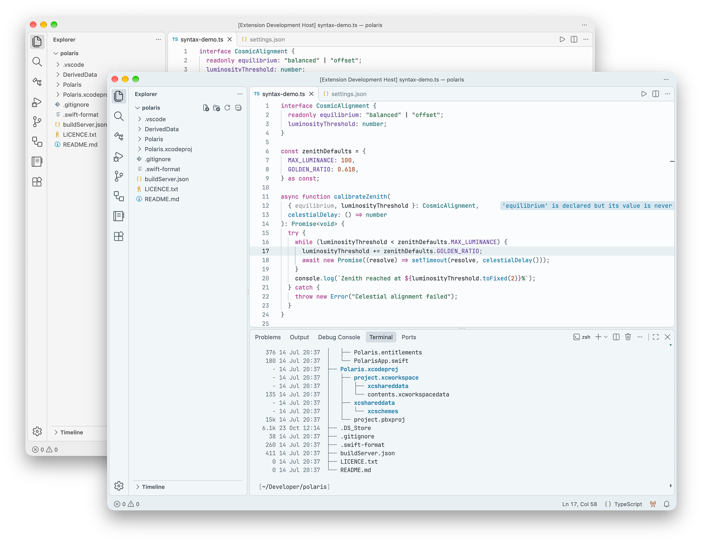

<div align="center">
  
  <h1>Meridian Theme for VS Code</h1>
  <p>
    <strong>A refined light theme with cohesive colors and complete UI coverage.</strong>
    <br>
    Comes in 💙 blue-tinted and 🩶 neutral variants.
    <br>
    Check out the 🌚 dark theme here: <a href="https://marketplace.visualstudio.com/items?itemName=britown.vscode-theme-zenith">Zenith Theme for VS Code</a>.
  </p>
  <br>
</div>



> [!NOTE]
> Updated for VS Code [Modern UI](https://code.visualstudio.com/blogs/2026/10/15/modern-ui). The updated themes are backward compatible, but you can switch to "Meridian (Legacy)" or "Meridian Neutral (Legacy)" if you prefer the old style.

## Installation

1. Install theme from the VS Code Marketplace ([direct link](https://marketplace.visualstudio.com/items?itemName=britown.vscode-theme-meridian))
2. Set your `Color Theme` to `Meridian`
3. Set your `File Icon Theme` to `Meridian` for file icons that match the theme colors
4. (Optional) Apply the suggested settings below

## Suggested settings

**Tabs**

VS Code supports **connected** (default) and **pill** tabs via `workbench.experimental.modernUIEditorTabStyle`. Add the color overrides for your tab style:

- **Connected tabs (default):** VS Code ignores a theme's hover colors for connected editor tabs, so they need to be set in your settings.

  ```json
  "workbench.colorCustomizations": {
    "[Meridian]": {
      "modernEditorTab.activeHoverBackground": "#fafcfd",
      "modernEditorTab.hoverBackground": "#00000000"
    },
    "[Meridian Neutral]": {
      "modernEditorTab.activeHoverBackground": "#fcfcfc",
      "modernEditorTab.hoverBackground": "#00000000"
    }
  }
  ```

- **Pill tabs:** Adjusts tab colors and adds a bottom border (omitted from the theme so it doesn't cross the active connected tab).

  ```json
  "workbench.colorCustomizations": {
    "[Meridian]": {
      "editorGroupHeader.border": "#cdd3d7",
      "tab.inactiveForeground": "#505b62",
      "tab.unfocusedInactiveForeground": "#505b62",
      "panelTitle.inactiveForeground": "#505b62",
      "activityBarTop.inactiveForeground": "#505b62",
      "modernTab.hoverBackground": "#102d3d16"
    },
    "[Meridian Neutral]": {
      "editorGroupHeader.border": "#d2d2d2",
      "tab.inactiveForeground": "#595959",
      "tab.unfocusedInactiveForeground": "#595959",
      "panelTitle.inactiveForeground": "#595959",
      "activityBarTop.inactiveForeground": "#595959",
      "modernTab.hoverBackground": "#00000013"
    }
  }
  ```

**Secondary side bar tabs (optional)**

With text labels, the active tab in the secondary side bar sits 1px lower than the divider below it (a VS Code bug; other tab bars are fine). To avoid it, show icons instead of labels:

```json
"workbench.activityBar.location": "top",
"workbench.panel.showLabels": false,
```

**Font**

The font in the screenshot is [JetBrains Mono](https://www.jetbrains.com/lp/mono/) with these settings:

```json
"editor.fontFamily": "JetBrains Mono",
"editor.fontLigatures": true, // If you want ligatures.
"editor.fontSize": 13,

"terminal.integrated.fontFamily": "JetBrains Mono",
"terminal.integrated.fontLigatures": true, // If you want ligatures.
"terminal.integrated.fontSize": 13,
"terminal.integrated.lineHeight": 1.1,
```

**UI elements**

```json
// Tone down the use of colors in Explorer and Editor.
"explorer.decorations.colors": false,
"outline.problems.colors": false,
"workbench.editor.decorations.colors": false,
"editor.bracketPairColorization.enabled": false,

// Extend Editor line highlight into gutter, adjust Scrollbar and resize indicator (Sash) sizes, and align Explorer file icons.
"editor.renderLineHighlight": "all",
"editor.scrollbar.horizontalScrollbarSize": 10,
"editor.scrollbar.verticalScrollbarSize": 10,
"workbench.tree.indent": 18,
"workbench.tree.renderIndentGuides": "none",
"workbench.sash.size": 2,
```

**Extensions**

Apply these if you use the following extensions:

```json
"errorLens.borderRadius": "4px",
"errorLens.margin": "6ch",
"errorLens.messageBackgroundMode": "message",
"errorLens.padding": "1px 4px",

"gitlens.currentLine.fontStyle": "italic",
```

**Other**

[suggested-settings.json](https://github.com/bkuzmanoski/vscode-theme-meridian/blob/main/suggested-settings.json) contains these and other theme- and layout-related settings for easy copy-and-pasting.

## Acknowledgments

The syntax highlighting colors were inspired by the "zenwritten_light" Ghostty theme ([mbadolato/iTerm2-Color-Schemes](https://github.com/mbadolato/iTerm2-Color-Schemes)) which was in turn taken from [mcchrish/zenbones.nvim](https://github.com/mcchrish/zenbones.nvim).

The file icon theme uses the Seti UI icons ([jesseweed/seti-ui](https://github.com/jesseweed/seti-ui)).

---

Found a bug or have a request? Please [open an issue](https://github.com/bkuzmanoski/vscode-theme-meridian/issues).
